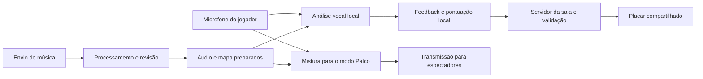

# Projeto de karaokê online — contexto e análise para o Claude

## Pedido ao Claude

Quero desenvolver um jogo independente de karaokê online, inspirado na experiência de canto e pontuação do Fortnite Festival. Leia este arquivo inteiro e use-o como contexto para me ajudar a transformar a ideia em um projeto executável.

Primeiro, avalie criticamente a proposta técnica e apresente um plano de desenvolvimento por etapas, começando pelo experimento que comprova a captação, o sincronismo e a pontuação da voz. Diferencie funcionalidades da primeira versão e funcionalidades posteriores. Explique as decisões em português do Brasil, de maneira clara. Não trate as sugestões desta análise como decisões que eu já aprovei.

## O que eu realmente pedi e confirmei

- Quero um jogo focado em colocar/escolher uma música, chamar amigos, cantar e receber pontuação.
- Os amigos estarão pela internet, cada um em sua própria casa. Essa preferência foi confirmada explicitamente.
- Quero uma análise detalhada de como o jogo poderia ser feito.
- O envio de músicas faz parte da visão do produto; se precisar ser desenvolvido por etapas, explique como chegaremos a ele.
- A referência é o tipo de experiência musical do Fortnite Festival, não uma obrigação de copiar sua identidade visual, personagens ou recursos.

## O que ainda é proposta, não requisito aprovado

- Usar navegador, React, TypeScript, Colyseus, LiveKit ou qualquer outra tecnologia específica.
- Começar em computador e adicionar suporte móvel depois.
- Limitar as salas a oito pessoas.
- Começar com três a cinco músicas preparadas.
- Ter os modos Disputa e Palco e usar a fórmula de pontuação apresentada abaixo.
- Adiar o processamento automático de qualquer música.

Apresente alternativas quando houver uma razão concreta. Preserve a experiência online entre amigos e o objetivo de adicionar músicas.

## Estado do trabalho

Foi realizada uma pesquisa e escrito um estudo de viabilidade em 13 de novembro de 2026. A pasta do projeto estava vazia antes desse estudo. Não foi implementado um jogo, não foram executados testes de canto e não existe desempenho ou capacidade de salas comprovados. Não há orçamento, prazo de lançamento, repertório ou provedor de hospedagem definidos.

O estudo utilizou orientações de skills sobre descoberta de ferramentas, concepção de produto, áudio de jogos, interface e desempenho React. Você não precisa ter essas skills instaladas para compreender este documento. A relação de skills abaixo registra o método da pesquisa; não exige instalar pacotes ou executar comandos.

## Cuidados ao continuar

- Diferencie fatos documentados, recomendações e hipóteses ainda não testadas.
- Verifique a documentação atual antes de implementar APIs ou escolher versões de bibliotecas.
- Trate detecção de afinação, reconhecimento das palavras e transmissão de voz como problemas distintos.
- Não prometa sincronismo perfeito entre todos os cantores em qualquer conexão.
- Não apresente extração automática de notas e letras de qualquer arquivo como problema já resolvido.
- Não confunda validar eventos no servidor com impedir toda fraude em um cliente controlado pelo jogador.
- Use as fontes externas indicadas para conferir detalhes. Este arquivo é autossuficiente e não depende do histórico da conversa anterior.

## Estudo de viabilidade completo

**Análise de viabilidade — jogo de karaokê online entre amigos**

Pesquisa realizada em 13/11/2026. Contexto confirmado: amigos pela internet, cada um em sua casa. A pasta inicial estava vazia. Este documento contém propostas e decisões a validar; não representa software implementado, testes executados ou um escopo já aprovado.

**O produto pode ser um jogo social acessado por link.** A pessoa cria uma sala privada, convida amigos, escolhe músicas e participa de rodadas com avaliação vocal. Minha recomendação é começar no navegador de computador, com interface em português, salas de 2 a 8 pessoas como alvo inicial de teste e um catálogo pequeno preparado. Celular permanece na visão do produto, com validação própria de microfones, interrupções e desempenho antes de prometer equivalência.

O diferencial seria tornar uma sessão entre amigos fácil de começar e divertida mesmo para quem canta mal: fila de músicas, participação como plateia, reações, revanche, evolução pessoal e resultados compreensíveis. Uma apresentação não termina antecipadamente porque alguém errou. Classificação competitiva e brincadeira social precisam conviver sem transformar toda música em uma prova intimidante.

**As skills foram usadas como orientação, complementadas por documentação técnica.** Li as skills locais e referências aplicáveis; a pesquisa externa passou pelo leaderboard e pelo CLI `npx skills find` com as consultas `pitch detection`, `multiplayer` e `web audio`.

| Skill existente | Aplicação nesta análise |
|---|---|
| find-skills | Busca e avaliação de procedência e adoção das novas candidatas. |
| brainstorming | Separação entre necessidades confirmadas, alternativas e hipóteses a validar. |
| game-audio | Canais separados de música, canto e efeitos; calibração; prioridade do áudio; carregamento e memória. |
| game-ui-ux | Fluxo de telas, leitura durante o canto, acessibilidade, foco e estados de reconexão. |
| vercel-react-best-practices | Separar atualizações rápidas do áudio das renderizações da interface e carregar recursos pesados quando necessários. |

Resultados da busca, com contagens observadas nesta sessão, que podem mudar:

| Candidata | Instalações no CLI | Estrelas do repositório da skill na API GitHub | Avaliação |
|---|---:|---:|---|
| rivet-dev/skills — multiplayer-game | 7,2 mil | 52 | Origem vinculada ao fornecedor Rivet e adoção relevante; a skill é específica de RivetKit. Poucas estrelas no repositório da skill pedem cautela; não é motivo suficiente para escolher esse backend. |
| colyseus/skill — colyseus | 275 | 3 | Origem na organização Colyseus. Li o conteúdo e confrontei suas orientações gerais com a documentação. Candidata condicional caso esse framework seja adotado; adoção da skill ainda limitada. |
| martinholovsky/claude-skills-generator — web-audio-api | 411 | 48 | Resultados de busca não demonstram qualidade suficiente para ser a principal referência de áudio. Não adotada. |
| danbennettuk/voice-note-to-midi — voice-note-to-midi | 48 | 1 | Baixa adoção e foco diferente de pontuação de canto em tempo real. Não adotada. |

Não instalei novas skills nesta análise. As candidatas de multiplayer acrescentam instruções sobre frameworks, mas não resolvem o avaliador musical. Os comandos condicionais são `npx skills add rivet-dev/skills --skill multiplayer-game` e `npx skills add colyseus/skill --skill colyseus`; são alternativas para uma futura escolha técnica, não instalações necessárias agora. Fontes: [Rivet no diretório](https://skills.sh/rivet-dev/skills/multiplayer-game), [repositório Rivet](https://github.com/rivet-dev/skills), [Colyseus no diretório](https://skills.sh/colyseus/skill/colyseus), [repositório da skill Colyseus](https://github.com/colyseus/skill). As contagens de estrelas se referem a esses repositórios, não aos projetos principais.

**Existem três abordagens reais de produto.**

| Abordagem | Vantagem | Trabalho ou limitação principal |
|---|---|---|
| Web com músicas preparadas | Entrar por convite é simples; permite validar canto e experiência social rapidamente. | Exige provar captação e sincronismo nos navegadores escolhidos. |
| Aplicativo desktop com controle de áudio mais dedicado | Mais espaço para integração de dispositivos e configuração de áudio. | Instalação, distribuição e suporte por sistema aumentam o trabalho e a fricção do convite. |
| Web com preparação automática de qualquer arquivo desde o início | Aproxima a promessa de colocar uma música e cantar. | Acumula desenvolvimento do jogo e pesquisa de separação, transcrição, alinhamento e extração melódica. |

Recomendo a primeira como ponto de partida, preservando o importador de arquivos como etapa posterior. Isso é uma recomendação minha; o usuário confirmou apenas o uso online entre amigos.

**Dois modos cobrem necessidades diferentes da mesma sala.** No modo Disputa, todos cantam simultaneamente acompanhando uma reprodução local da mesma música. Cada pessoa recebe feedback imediato; os placares circulam pela rede. A voz dos demais fica silenciada por padrão durante a execução, e a conversa volta no intervalo. Há presença social por avatares, progresso e reações visuais discretas.

No modo Palco, uma pessoa canta e as outras escutam. Há fila, possibilidade de passar a vez, aplausos e pontuação vocal. O público pode reagir, mas a reação não altera a medida de precisão. Esse modo é importante para a promessa de ouvir amigos; só construir placares simultâneos deixaria parte da experiência social de fora.

Um terceiro modo, coro ou dueto com todos se ouvindo em tempo real, merece investigação posterior. Não é impossível em condições favoráveis, mas a latência de dispositivos e rede impede garantir uma experiência musical uniforme para amigos em qualquer conexão. A documentação do Jamulus também destaca limites de latência e cuidados com dispositivos sem fio. [FAQ do Jamulus](https://jamulus.app/pt-BR/wiki/FAQ).

**Sincronizar uma partida não equivale a sincronizar um coral remoto.** Na Disputa, todos carregam a mesma versão do áudio e do mapa vocal; o servidor confirma que estão prontos e agenda um início futuro. Cada cliente estima sua diferença de relógio em relação ao servidor e agenda a reprodução no relógio de áudio local. A avaliação usa a posição da música e o atraso de captura calibrado, e não o momento em que um pacote chegou pela internet.

A arquitetura proposta separa três tempos: posição musical local, tempo compartilhado da rodada e posição de apresentação da mídia para espectadores. Atrasos e oscilação do placar remoto não devem afetar a nota local. Oscilação ou suspensão do áudio local, por outro lado, afetam a validade da execução e precisam aparecer como problema de dispositivo. Se uma aba suspender a reprodução, não basta continuar somando pontos como se nada tivesse ocorrido.

O Web Audio fornece um relógio próprio, `currentTime`; `getOutputTimestamp()` ajuda a relacionar a saída de áudio com o relógio de desempenho. Isso não elimina a necessidade de medir atraso de entrada, saída e processamento, nem garante precisão idêntica em todo hardware. [Relógio de áudio](https://developer.mozilla.org/en-US/docs/Web/API/BaseAudioContext/currentTime), [timestamp de saída](https://developer.mozilla.org/en-US/docs/Web/API/AudioContext/getOutputTimestamp).

**O modo Palco precisa entregar acompanhamento e voz alinhados ao público.** Uma opção de protótipo é criar, no aparelho do cantor, uma mistura de voz e acompanhamento destinada aos espectadores. O acompanhamento desse fluxo deve ser atrasado de acordo com a latência local medida para acompanhar a voz capturada. O cantor continua ouvindo sua base local, sem receber o retorno atrasado do próprio canto.

Os espectadores recebem a mistura como um único fluxo. Isso mantém as duas partes juntas durante o transporte, desde que estejam alinhadas antes da mistura. O público não deve reproduzir outra cópia local da base sobre esse fluxo. Letras, pontuação e reações da plateia precisam acompanhar a posição de apresentação remota; o último placar recebido por WebSocket pode estar adiantado em relação ao som ouvido. A tolerância dessa sincronização deve ser medida no protótipo. Outra opção é transportar faixas separadas com timestamps e buffers, oferecendo mais controle ao custo de maior complexidade.

**A jornada do usuário deveria caber em poucos passos.**

1. Abrir um convite, escolher apelido e avatar e entrar na sala.
2. Escolher entre cantar e assistir; solicitar acesso ao microfone quando fizer sentido.
3. Testar entrada de voz, volume, fones e sincronismo numa frase curta.
4. Escolher uma música preparada ou acompanhar o estado de processamento de um envio.
5. Confirmar participação, ver a contagem regressiva e cantar.
6. Conferir resultado, conversar e votar na próxima música ou revanche.

O acesso ao microfone no navegador depende de permissão e contexto seguro, normalmente HTTPS. A interface precisa distinguir acesso negado, dispositivo ausente e erro de captura. Uma pessoa sem microfone ainda pode ser espectadora. [Documentação de getUserMedia](https://developer.mozilla.org/en-US/docs/Web/API/MediaDevices/getUserMedia).

**A tela de canto deve priorizar leitura e orientação.** Proponho a letra atual em destaque, a próxima frase menor, uma faixa horizontal de notas e o traço da voz detectada. Um marcador fixo mostra o instante atual; a altura vertical representa grave/agudo. Quem não entende teoria musical deve conseguir seguir o movimento. Os nomes das notas podem ficar numa opção avançada.

Pontuação e combo ocupam uma área secundária. O progresso dos amigos cabe numa faixa lateral, sem cobrir letras. Um palco ilustrado, avatares simples e iluminação podem criar identidade sem exigir um ambiente 3D. Cores precisam vir acompanhadas de forma ou texto, com tamanho de letra ajustável, opção de reduzir movimento e navegação por teclado. O lobby pode adaptar-se ao celular; a tela de canto móvel precisa ser desenhada e testada separadamente.

**Pontuar a voz exige conhecer previamente o que deveria ser cantado.** Cada música precisa de um mapa contendo início e fim das frases, notas esperadas, duração, sílabas ou palavras, pausas e trechos falados. O formato UltraStar já descreve notas, duração, altura e texto, sendo uma referência útil para importação. Compatibilidade exige respeitar a versão e converter sua base de tempo, sem presumir que todas as variantes sejam iguais. Importar o mapa também não fornece automaticamente o áudio correspondente. [Especificação UltraStar](https://usdx.eu/format/).

Proponho um pacote interno com `songId`, versão do arranjo, identificação do áudio, duração, offsets, frases, notas, idioma, créditos e estado de revisão. O ranking deve incluir a versão do mapa e da regra de pontuação: corrigir notas de uma faixa não pode misturar resultados incomparáveis. A edição exata da gravação importa; rádio, álbum e versão ao vivo podem ter tempos diferentes.

**O avaliador pode começar sem um modelo grande de IA.** O navegador captura amostras, estima a frequência fundamental e sua confiabilidade e compara o resultado com o mapa vocal no tempo musical. Pitchy é uma candidata para o primeiro experimento: sua documentação descreve detecção em JavaScript pelo método McLeod e retorno de frequência e clareza. É uma biblioteca de detecção; não fornece por si só avaliação justa de karaoke. [Pitchy](https://github.com/ianprime0509/pitchy).

O processamento deve operar fora das renderizações da interface. `AudioWorklet` fornece execução de áudio numa thread separada, mas algoritmos pesados ainda precisam respeitar o orçamento de processamento ou ser distribuídos para um worker. Reutilizar buffers e enviar resumos reduz pausas e trabalho desnecessário. [AudioWorklet](https://developer.mozilla.org/en-US/docs/Web/API/AudioWorklet).

**A primeira fórmula deve ser explicável e repetível.** Como hipótese inicial, atribuir a cada pequeno intervalo vocal esperado um valor de acerto entre 0 e 1 e ponderá-lo pela duração. A pontuação base seria:

`pontos = 10.000 × soma(duração × acerto) / soma(duração vocal esperada)`

O denominador usa a referência, não apenas os trechos detectados do jogador. Silêncio durante uma nota esperada vale zero; caso contrário, alguém poderia cantar só a parte fácil e parecer perfeito. Pausas instrumentais ficam fora. Um erro de captura identificado deve invalidar ou marcar a execução incompleta, sem redefinir o denominador para favorecer o resultado.

A distância de afinação pode ser calculada em cents: `1200 × log2(frequência cantada / frequência alvo)`. Uma regra casual pode aceitar oitavas equivalentes para acomodar vozes graves e agudas. Isso deve ser uma opção explícita do modo, registrada no resultado, e não uma tentativa de exigir o timbre do artista. Em dificuldade maior, reduzir a tolerância de afinação e entrada, sempre com parâmetros calibrados por testes.

Sustentação e tempo já afetam a cobertura da nota; somá-los outra vez com pesos arbitrários pode punir o mesmo erro duas vezes. A interface pode explicar afinação, entradas e sustentação separadamente, enquanto o placar base continua usando uma regra coerente. Combo e efeitos comemorativos podem ser inicialmente apenas visuais, facilitando comparar desempenho. Rap e fala devem ser marcados como não tonais ou ficar fora do primeiro catálogo, evitando cobrar uma nota musical que não existe.

Pronúncia e avaliação da letra não entram no primeiro avaliador. Cantar uma vogal na afinação correta pode pontuar nesse modelo; é consequência da regra proposta. Se reconhecer palavras virar objetivo, será um problema adicional a validar com sotaques, idiomas e canto prolongado. Reações dos amigos e preferências musicais também não entram na medida objetiva.

**O som precisa de canais separados.** Base instrumental, vocal guia, voz própria, voz da sala e efeitos devem ter controles independentes. A análise recebe a voz antes de efeitos de apresentação. Reverberação ou mudança estética de voz, se existirem depois, não devem melhorar a nota. Durante a música, efeitos e avisos não podem encobrir a melodia.

Fones ajudam a impedir que a base saia pelas caixas e retorne ao microfone. Supressão de ruído, controle automático de ganho e cancelamento de eco precisam ser avaliados para canto; não basta usar um perfil de chamada de voz sem conferir o resultado. LiveKit documenta configurações para áudio musical, incluindo opções de captura e transmissão. Essa capacidade torna a ferramenta candidata ao modo Palco, mas não prova o sincronismo do nosso produto. [Áudio musical no LiveKit](https://docs.livekit.io/transport/media/advanced/).

**O envio de músicas deve mostrar o estado real de preparação.** Um arquivo passa por validação e processamento: identificar duração e formato, obter acompanhamento quando necessário, extrair uma referência melódica, alinhar a letra, revisar os resultados e gerar o pacote. As etapas podem falhar individualmente. O produto deve mostrar preparação em andamento, faixa pronta ou trecho que precisa de correção, sem chamar uma extração incerta de resultado definitivo.

Há três níveis de entrada: pacote já preparado, áudio acompanhado de mapa e letra, ou áudio sem referências. O primeiro é mais previsível; o último exige mais processamento e revisão. Basic Pitch converte áudio em eventos musicais/MIDI, mas seu próprio projeto afirma que funciona melhor com um instrumento por vez. Portanto, não se deve assumir que passar uma música completa com bateria, backing vocals e instrumentos vai produzir uma melodia principal correta. [Basic Pitch da Spotify](https://github.com/spotify/basic-pitch).

Um caminho de evolução é manter uploads em salas privadas com classificação de qualidade do mapa e permitir revisão antes de habilitar comparação competitiva. Faixas automáticas não revisadas podem ser usadas em modo experimental, com indicação clara. Um editor interno para corrigir início de sílaba, duração e nota costuma ser uma peça importante desse fluxo.

Link de streaming e arquivo de áudio são entradas diferentes. Não proponho uma dependência de baixar ou separar áudio de vídeos do YouTube: as políticas da API restringem separar ou modificar componentes audiovisuais. O primeiro catálogo pode usar músicas próprias ou autorizadas, com origem e permissões de uso registradas. Disponibilizar um catálogo comercial e redistribuir uploads são decisões de conteúdo a resolver antes do lançamento público. [Políticas da API do YouTube](https://developers.google.com/youtube/terms/developer-policies).

**A arquitetura recomendada mantém áudio, estado da sala e processamento de músicas separados.**

| Parte | Proposta inicial | Motivo |
|---|---|---|
| Interface | TypeScript e React; Canvas para a faixa de notas | Menus e lobby separados da animação contínua. |
| Captura e reprodução | Web Audio e AudioWorklet | Acesso a áudio e processamento local com relógio musical. |
| Detector | Experimento com Pitchy | Ponto inicial simples, sujeito a teste com vozes reais. |
| Salas | Node.js e Colyseus como candidato principal | Salas, sincronização de estado e reconexão documentadas. |
| Voz e apresentação | WebRTC, com LiveKit como candidato | Transporte de mídia separado dos eventos do jogo. |
| Dados persistentes | PostgreSQL | Histórico, catálogo, versões e resultados. |
| Arquivos | Armazenamento de objetos | Áudio e mapas fora das mensagens da sala. |
| Importação futura | Serviço assíncrono e fila de trabalhos | Processamento de arquivos sem travar partidas. |

A biblioteca de salas não sincroniza automaticamente notas e som. A implementação continua responsável por relógios, preparação, validação e regras. Colyseus é uma opção documentada para estado autoritativo e ciclo das salas; um servidor WebSocket menor também é possível, mas exigiria implementar mais desses mecanismos. [Salas Colyseus](https://docs.colyseus.io/room), [conexão e reconexão](https://docs.colyseus.io/sdk/connection).

Não é necessário hospedar todas as partes no mesmo serviço. O servidor de sala precisa sustentar conexões e estado; a preparação musical pode exigir recursos muito diferentes; a transmissão de mídia tem custo ligado a tráfego e participantes. A escolha do provedor deve ocorrer depois de medir a prova técnica.

**A sala deve ter uma sequência explícita de estados.** A proposta é `aguardando → preparando → prontos → contagem → cantando → resultados → aguardando`. O servidor controla a música, a versão da regra, os participantes e o início da rodada. Alterações de repertório valem para a rodada seguinte. Entrar no meio significa assistir até a próxima, sem comparar uma execução parcial com apresentações completas.

Se o anfitrião sair, o servidor escolhe um sucessor entre os participantes presentes. Se alguém desconectar, existe uma janela limitada de reconexão; a música dos demais continua. Pacotes de pontuação usam identificador de rodada, sequência e tempo musical, com rejeição de duplicatas e limites plausíveis. O resultado final só aparece como confirmado após o fechamento da rodada e a validação; dados faltantes são sinalizados como incompletos.

**Servidor autoritativo não torna uma pontuação local impossível de fraudar.** O servidor pode recalcular uma nota a partir de eventos, limitar o máximo por trecho e rejeitar tempos incoerentes. Ainda assim, quem controla o cliente pode fabricar frequências ou enviar uma gravação. Para salas entre amigos, essa limitação pode ser aceitável. Um ranking global competitivo exigiria um projeto adicional de validação e política de participação; não basta receber um total e gravá-lo como recorde confiável.

Proponho não guardar gravações por padrão. No modo Disputa, o canto pode ser analisado localmente e só eventos necessários são enviados; no modo Palco, a interface informa que o áudio está sendo transmitido. Gravar, criar replay ou publicar clipes seriam ações explícitas posteriores. A sala deve oferecer sair, silenciar e remover participante, com indicação clara de quem está no microfone.

**A primeira versão deve demonstrar a experiência completa com poucos conteúdos.** Minha proposta é 3 a 5 músicas ou trechos autorizados e revisados, treino solo, sala privada, convite, apelido, teste de microfone, Disputa, Palco básico, pontuação, resultados e revanche. O limite de 8 participantes é um alvo de validação, não capacidade comprovada.

O teste solo vem primeiro por dependência técnica, mas não é a entrega final da visão. Depois se prova a Disputa em dois computadores em redes diferentes; em seguida, o Palco com público remoto. Só então faz sentido ampliar salas, repertório e importação automática. Avatares 3D, economia de moedas, loja, ranking público, gravação e harmonias simultâneas podem esperar até a sessão musical funcionar bem.

**A validação precisa testar justiça, além de verificar se o programa abre.** Estes são critérios propostos, ainda não executados:

| Experimento | Evidência necessária |
|---|---|
| Áudio sintético conhecido | Frequência correta, erro controlado de afinação e silêncio produzem a ordem esperada de pontuação. |
| Execução repetida | A mesma gravação de teste com a mesma configuração gera pontuação reproduzível. |
| Ritmo e sustentação | Entradas atrasadas e notas cortadas reduzem a cobertura; pausas instrumentais não penalizam. |
| Vozes reais variadas | Graves, agudos, vibrato, respiração e consoantes não criam falsos acertos sistemáticos. |
| Calibração | Atraso conhecido é recuperado; trocar o dispositivo invalida ou solicita revisão da configuração. |
| Rede com atraso e perda | Atrasar pacotes do placar não altera a avaliação musical local; resultados duplicados não contam duas vezes. |
| Palco remoto | Ouvintes escutam voz e base alinhadas; não há dupla base nem retorno do cantor para si mesmo. |
| Falhas do microfone | Permissão negada, cabo removido e interrupção geram estados claros. |
| Suspensão e reconexão | Uma execução interrompida não recebe resultado completo indevido. |
| Interface | Letra legível, controles acessíveis e animações sem bloquear captura em aparelhos-alvo. |

Metas numéricas de erro em cents, atraso percebido e consumo de CPU devem ser definidas usando esse corpus. Não existe medição própria nesta etapa. A primeira prova técnica deve registrar essas métricas e ser capaz de reprovar a biblioteca escolhida, em vez de adaptar os critérios para aceitá-la.

**O desenvolvimento pode ser dividido em entregas verificáveis.**

| Entrega | Conteúdo | Condição para avançar |
|---|---|---|
| 1. Prova vocal | Uma referência preparada, captura, calibração e pontuação local | Erros conhecidos recebem resultados coerentes e repetíveis. |
| 2. Rodada entre amigos | Convite, servidor da sala, início agendado, Disputa e resultados | Dois jogadores em redes diferentes completam a mesma rodada e recebem o mesmo resultado compartilhado. |
| 3. Experiência social | Palco, transmissão, fila, reações e reconexão | Público escuta a apresentação de forma alinhada e o ciclo funciona sem intervenção técnica. |
| 4. Catálogo e operação | Conteúdo preparado, versões, armazenamento, métricas e limites | Novas faixas entram sem quebrar resultados anteriores. |
| 5. Importação assistida | Upload, processamento, revisão e classificação de qualidade | Faixas aceitas passam por critérios mínimos de alinhamento e referência. |

Estimar prazo fechado antes da prova vocal esconderia a maior incerteza. O esforço das salas é mais previsível do que o de pontuação em diferentes dispositivos e importação automática. O primeiro experimento deve reduzir essas incertezas antes de contratar serviços ou dimensionar um lançamento.

**O custo depende sobretudo de mídia e preparação, além da hospedagem básica.** O modelo de orçamento é: execução do backend + banco + armazenamento + entrega de músicas + transmissão de voz + processamento dos envios + trabalho de preparar e disponibilizar repertório. Sem saber minutos de uso, simultaneidade e volume de uploads, um preço mensal em reais seria uma suposição.

Uma estimativa dimensional ajuda a entender transmissão: bitrate em kbit/s × segundos × número de ouvintes ÷ 8.000.000 resulta aproximadamente em GB decimais de carga útil. Por exemplo, 128 kbit/s por 3 minutos para 7 espectadores representa cerca de 0,020 GB de saída só daquela faixa, antes de overhead e retransmissões. É uma hipótese de tráfego, não um preço nem uma recomendação final de bitrate. Gravação, múltiplas vozes simultâneas e retenção de uploads aumentam outras parcelas.

**As decisões ainda abertas podem ser resolvidas sem descartar a análise.** Permanecem a prioridade entre Palco e Disputa, o suporte inicial a celular, o repertório, a política de publicação de uploads e o nível de competição. Minha proposta é validar ambos os modos sociais em desktop, usar mapas revisados para pontuação comparável e manter músicas automáticas em preparação assistida até demonstrar qualidade. A escolha técnica mais importante é provar que o jogo reconhece e avalia canto de forma consistente antes de investir em cenários, catálogo amplo ou progressão.

